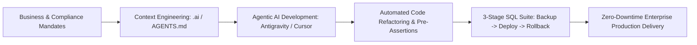

<div align="center">

# 🚀 ABHAY KUMAR SINGH
### **Senior Full Stack Web Developer & AI Solutions Engineer**

[](https://www.php.net/)
[](https://docs.mezzio.dev/)
[](https://codeigniter.com/)
[](https://www.mysql.com/)
[](#-applied-ai--developer-automation-ecosystem)
[](#-enterprise-banking-modules-axis-bank)

<br/>

📍 **New Delhi, India** &nbsp;|&nbsp; 
📞 **[+91-8750908036](tel:+918750908036)** &nbsp;|&nbsp; 
📧 **[as271070@gmail.com](mailto:as271070@gmail.com)** &nbsp;|&nbsp; 
💼 **[LinkedIn](https://www.linkedin.com/in/abhaywebdeveloper/)** &nbsp;|&nbsp; 
🐙 **[GitHub](https://github.com/abhaywebdeveloper/)** &nbsp;|&nbsp; 
🌐 **[Interactive Web Resume](https://webdevelopmentsolution.in/abhaywebdeveloper.github.io)**

---

### 📊 KEY IMPACT & SCALE AT A GLANCE

| **6+ Years** | **10+ Modules** | **2,50,000+ Users** | **+40% Velocity** | **-65% SQL Latency** | **100+ Solutions** |
| :---: | :---: | :---: | :---: | :---: | :---: |
| Full-Stack & AI Engineering | Mission-Critical Axis Bank BFSI | Pan-India Public Platform (QCI) | Agentic AI Productivity Boost | Bulk Batch DB Optimization | Successfully Delivered |

---

</div>

## 📑 TABLE OF CONTENTS
- [🧾 Executive Summary](#-executive-summary)
- [🛠️ Technical Stack & Architectural Matrix](#️-technical-stack--architectural-matrix)
- [🤖 Applied AI & Developer Automation Ecosystem](#-applied-ai--developer-automation-ecosystem)
- [💼 Professional Experience](#-professional-experience)
- [🏦 Enterprise Banking Modules (Axis Bank BFSI)](#-enterprise-banking-modules-axis-bank-bfsi)
- [🌟 Flagship Government & Enterprise Projects](#-flagship-government--enterprise-projects)
- [📂 Featured Commercial & Digital Portfolio (100+ Solutions)](#-featured-commercial--digital-portfolio-100-solutions)
- [🎓 Education & Continuous Specialization](#-education--continuous-specialization)
- [👤 Personal Details & Declaration](#-personal-details--declaration)
- [📬 Connect With Me](#-connect-with-me)

---

## 🧾 EXECUTIVE SUMMARY

> [!IMPORTANT]
> **Senior Full Stack Web Developer & AI Solutions Engineer** with **6+ years of specialized experience** designing, engineering, and scaling mission-critical web applications across **enterprise banking (BFSI)**, **national regulatory authorities (QCI)**, and **high-volume commercial ecosystems**.

* **Core Architectural Mastery:** Advanced expertise in **PHP 8+, Mezzio Framework (Laminas/Zend), CodeIgniter 3 & 4 (CI3/CI4), MySQL, and RESTful Microservices**, delivering enterprise-grade software emphasizing clean architecture, high concurrency, and zero downtime.
* **Modern Agentic AI & LLM Pioneer:** Integrating modern AI developer workflows (**Google Antigravity IDE, Cursor AI, Claude Code, GitHub Copilot**) and **LLM APIs (OpenAI, Gemini, Claude)** directly into development sprints—accelerating delivery turnaround by **40%**, automating AST code refactoring, and orchestrating strict zero-data-loss database patch suites.
* **Proven Enterprise Track Record:** Architect of branch banking platforms for **Axis Bank** handling high-volume daily branch transactions with strict 100% data integrity and zero data loss, alongside nationwide public sector portals empowering over **2,50,000 active village heads**.
* **Security & Regulatory Compliance:** In-depth knowledge of **Aadhaar eKYC (UIDAI compliant)**, RBI mandates, data masking, SHA-256 payload encryption, and OWASP web security standards.

---

## 🛠️ TECHNICAL STACK & ARCHITECTURAL MATRIX

| Engineering Domain | Core Technologies & Frameworks | Architectural Capabilities |
| :--- | :--- | :--- |
| **Backend & Microservices** | Core PHP (7.4 / 8.x), Mezzio (Laminas/Zend), CodeIgniter 3 & 4 | OOP, SOLID Principles, PSR-7 / PSR-15 Middleware Pipelines, MVC/HMVC, Design Patterns, RESTful Endpoints, Modular Clean Architecture |
| **Relational Databases** | MySQL 5.7 / 8.0, Oracle 10g/11g, phpMyAdmin | ACID Compliance, High-Throughput Bulk Operations, B-Tree Index Optimization, Snapshot Backup Tables (`_BK_`), Point-in-time Recovery, Zero-Loss Rollback Scripts |
| **Applied AI & Automation** | OpenAI API (GPT-4o), Google Gemini API, Anthropic Claude API, Google Antigravity IDE, Cursor AI, Claude Code, Windsurf | LLM Microservices, Prompt Workflows, Agentic Coding Workflows, Autonomous Subagents, Context Modeling (`.ai` / `AGENTS.md`), AST Refactoring |
| **Integrations & FinTech** | Aadhaar eKYC (UIDAI Compliant), Payment Gateways (Razorpay, Paytm, CCAvenue, Cashfree) | Core Banking System (CBS) Interfaces, Webhook Receivers, Biometric Data Handlers, JSON/XML APIs, Secure cURL Services |
| **Frontend Engineering** | HTML5, CSS3, JavaScript (ES6+), jQuery, Bootstrap (4/5), Tailwind CSS | Asynchronous AJAX Data Binding, Responsive Mobile-First Design, Micro-Interactions, SEO Optimization, Dynamic DOM Rendering |
| **DevOps & Infrastructure** | Linux CLI, Apache & WampServer, cPanel & VPS Hosting, Git, SVN, NFS SmartPDF Storage | 3-Stage SQL Release Suites, Zero-Downtime Patch Engineering, SSL/TLS Encryption, DNS Routing, File System Partitioning |

---

## 🤖 APPLIED AI & DEVELOPER AUTOMATION ECOSYSTEM

> [!TIP]
> **Engineering with AI as a Force Multiplier:** Rather than treating AI as a casual chat interface, I embed AI deeply into software architecture, context engineering, automated release suites, and developer velocity.



### 1. 🧠 LLM API Integrations & Smart Services
* **Enterprise AI Endpoints:** Engineered RESTful integration bridges consuming **OpenAI API (GPT-4o)**, **Google Gemini**, and **Claude API** for intelligent text summarization, data extraction, and form field autofill.
* **Document Parsing & OCR Verification:** Built multi-pass data validation pipelines cross-verifying extracted Aadhaar OCR payloads against form inputs to detect tampering and identity mismatches prior to core banking submission.

### 2. 🛠️ Agentic IDEs & Autonomous Subagents
* **Agentic Pair Programming:** Pioneered the structured adoption of **Google Antigravity IDE**, **Cursor AI**, and **Claude Code** across enterprise projects, boosting sprint velocity by **+40%**.
* **Deterministic Code Upgrades:** Used AI subagents to perform Abstract Syntax Tree (AST) migrations, upgrading legacy PHP codebases to PHP 8.x standards with automated regression test cases.

### 3. 📐 Repository Memory Systems (`.ai` & Rules Engines)
* **Persistent AI Context Architecture:** Architected hierarchical context systems (`.ai/index.md`, operational guidelines, domain invariants) ensuring zero-hallucination code generation across complex enterprise repositories.
* **Enforced Coding Standards:** Maintained repository-specific `AGENTS.md` and `.cursorrules` defining table prefix invariants, row-count check triggers, and mandatory rollback guarantees.

### 4. ⚙️ Bulletproof Database Release Automation
* **Automated 3-Stage Release Trilogies:** Standardized production database patches into three discrete, auditable components:
  1. `01_backup.sql`: Snapshot live state into timestamped `_BK_<DATE>` tables with pre-flight assertions.
  2. `02_deploy.sql`: Atomic multi-row `INSERT INTO ... VALUES` transactions with row-count verification.
  3. `03_rollback.sql`: Instant, non-destructive restoration scripts ready for automated rollback if verification fails.

---

## 💼 PROFESSIONAL EXPERIENCE

### **Software Developer** | **Sapple Systems**
*🗓️ Jan 2023 – Present &nbsp;|&nbsp; 📍 New Delhi, India*  
*⚡ Key Metrics: `+40% Sprint Velocity via AI` • `65% SQL Latency Reduction` • `Zero-Downtime Releases` • `Axis Bank BFSI Solutions`*

* **Enterprise Banking Platform Engineering:** Designed and scaled high-security branch banking modules for **Axis Bank** utilizing **Mezzio PHP Framework (Laminas)** and MySQL/Oracle, servicing tens of thousands of branch requests daily.
* **Agentic AI Workflow Integration:** Embedded autonomous coding workflows (Google Antigravity IDE, Cursor AI, GitHub Copilot) into the engineering lifecycle, accelerating feature turnaround by **40%** while identifying subtle edge cases prior to staging.
* **Zero-Downtime Patch Architecture:** Pioneered standardized 3-stage SQL deployment suites (`01_backup`, `02_deploy`, `03_rollback`) featuring row-count assertion tests, guaranteeing zero data loss across critical banking releases.
* **Bulk Database Optimization:** Architected single multi-row bulk insert/update strategies across form-marker mapping tables, reducing relational query execution latency by over **65%**.
* **Identity Security & UIDAI Compliance:** Implemented regulatory-compliant **Aadhaar eKYC** verification pipelines with SHA-256 payload encryption, customer data masking, and tamper-proof audit trails complying with RBI guidelines.
* **Cross-Functional System Leadership:** Collaborated with enterprise bank solution architects, security auditors, and QA leads to convert complex regulatory mandates into production-ready software specifications.

---

### **Software Developer** | **Orrish IT Solution Design**
*🗓️ Jan 2021 – Dec 2023 &nbsp;|&nbsp; 📍 New Delhi, India*  
*⚡ Key Metrics: `2,50,000+ Sarpanch User Base` • `45% Server Latency Reduction` • `CodeIgniter 4 Modernization`*

* **National-Scale Public Sector Engineering:** Engineered high-concurrency RESTful microservices and administrative dashboards for the **Sarpanch Samvaad platform** (Quality Council of India / Ministry), connecting over **2,50,000 village heads** across India.
* **Framework Architecture Modernization:** Spearheaded the architectural migration of legacy monolithic PHP applications into clean **CodeIgniter 4 (CI4)** MVC patterns, slashing average response times by **45%**.
* **FinTech & Messaging Integration:** Built automated multi-gateway payment processing (Razorpay, Paytm) and high-throughput transactional SMS/email dispatch microservices.
* **Server & Cloud Administration:** Managed VPS Linux hosting environments, automated recurring cron backup suites, installed SSL/TLS certificates, and configured domain DNS routing with high uptime.

---

### **Software Developer** | **Five Design**
*🗓️ Jan 2020 – Jan 2021 &nbsp;|&nbsp; 📍 New Delhi, India*  
*⚡ Key Metrics: `20+ Commercial Platforms Shipped` • `100% Mobile-First Responsive UI`*

* **Full-Stack Commercial Applications:** Delivered 20+ responsive web applications and bespoke e-commerce portals for domestic and overseas clients with mobile-first UI architecture.
* **Interactive Frontend & API Binding:** Engineered responsive user interfaces using HTML5, CSS3, JavaScript (ES6+), jQuery, and Bootstrap, integrated with asynchronous AJAX data pipelines.
* **Quality Standards & SEO Engineering:** Partnered with creative designers and QA analysts to guarantee sub-second load times, cross-browser compatibility, and search engine optimization.

---

## 🏦 ENTERPRISE BANKING MODULES (AXIS BANK BFSI)

> **Core Stack:** Mezzio PHP Framework (Laminas/Zend) &bull; MySQL 8.0 / Oracle 10g/11g &bull; NFS SmartPDF Storage &bull; RESTful CBS Services

| Module Name | Domain & Scope | Core Architectural Highlights & Technical Deliverables |
| :--- | :---: | :--- |
| **ReKYC-RI** *(Resident Indian)* | `BFSI Core` | End-to-end periodic KYC digital refresh platform with automated Aadhaar biometric validation, identity document upload pipelines, dynamic form rendering, and customer verification workflows. |
| **ReKYC-NRI** *(Non-Resident)* | `Compliance` | Cross-border regulatory compliance workflow handling foreign passport/visa validation, overseas address verification, embassy stamp authentication, and multi-tier bank officer sign-offs. |
| **Scheme Conversion** | `High Volume` | High-throughput account type upgrade/downgrade engine featuring dynamic multi-page PDF generation, NFS template cleansing, single multi-row marker mapping, and atomic database commits. |
| **Aadhaar Seeding** | `UIDAI Secure` | Account-to-Aadhaar linking module adhering strictly to UIDAI encryption standards, status tracking callbacks, and NPCI mapper validation routines. |
| **Auto FD** *(Fixed Deposit)* | `Core FinTech` | Automated term deposit creation workflow integrated with core banking interest calculation systems, maturity instructions, and nominee inheritance rules. |
| **Burgundy Banking** | `HNI Services` | Premium High-Net-Worth customer relationship onboarding platform featuring tailored banking privileges, wealth management routing, and priority verification pipelines. |
| **Family Banking** | `Relational` | Hierarchical account clustering system enabling pooled balance eligibility, multi-generational tier upgrades, and consolidated family statement views. |
| **Nominee Management** | `Audit Ready` | Comprehensive nomination registration, percentage allocation, deletion, and modification workflows with strict lineage validation and guardian consent tracking. |
| **DEAF Claim** | `RBI Mandate` | Depositor Education and Awareness Fund claim engine for processing unclaimed deposits, historical ledger reconciliation, and claim settlement conforming to RBI directives. |
| **M2M** *(Account Transfers)* | `Intra-Branch` | Automated intra-branch and inter-account mapping and balance transfers with multi-step authorization state machines and tamper-proof ledger audit logging. |

---

## 🌟 FLAGSHIP GOVERNMENT & ENTERPRISE PROJECTS

### 🏛️ NABCB Accreditation Portal
* **Client:** National Accreditation Board for Certification Bodies (**Quality Council of India - QCI**)
* **Duration:** Jan 2023 – Jul 2025
* **Tech Stack:** PHP, CodeIgniter 4, MySQL, Bootstrap, jQuery, AJAX, REST APIs
* **Live Production URL:** [nabcbportal.qci.org.in ↗](https://nabcbportal.qci.org.in)
* **Key Achievements:**
  * **Accreditation Lifecycle Management:** Architected the complete end-to-end accreditation portal governing certification bodies nationwide in alignment with international **ISO/IEC compliance standards**.
  * **Granular Role-Based Access Control (RBAC):** Designed multi-tiered role access permissions for assessors, lead evaluators, secretariats, and applicant certifying bodies with strict document-level security.
  * **Automated Compliance Follow-up Engine:** Built automated notification triggers for audit non-conformities, surveillance schedules, assessor assignments, and renewal timelines, drastically reducing manual administrative workload.

---

### 🌐 Sarpanch Samvaad Pan-India Application
* **Client:** Ministry / Quality Council of India (QCI)
* **Duration:** Jul 2022 – Aug 2023
* **Tech Stack:** PHP, CodeIgniter 4, MySQL, High-Concurrency REST APIs, JSON Microservices
* **Scale:** **2,50,000+ (2.5 Lakh) Active Sarpanchs (Village Heads)** across India
* **Key Achievements:**
  * **Grassroots Digital Connectivity:** Engineered scalable RESTful backend services powering a nationwide networking platform connecting village heads across all states of India.
  * **Multilingual Scheme Dissemination:** Developed localized content feeds, government developmental updates, peer-to-peer discussion boards, and real-time announcement channels.
  * **High-Concurrency Tuning:** Optimized MySQL database indexing, caching layers, and connection pooling to seamlessly handle viral traffic surges and concurrent user interactions without latency degradation.

---

## 📂 FEATURED COMMERCIAL & DIGITAL PORTFOLIO (100+ Solutions)

<details open>
<summary><b>🔍 Click to expand featured projects</b></summary>
<br/>

| Project Name | Category | Tech Stack | Key Capabilities & Impact |
| :--- | :---: | :--- | :--- |
| **🛍️ Poolxpool Products** | `E-Commerce` | PHP, MySQL, Bootstrap, AJAX, TCPDF | Swimming pool accessories marketplace featuring dynamic category filtering, shopping cart workflows, automated PDF invoice generation, and SEO-optimized architecture. |
| **🤝 Niswarth Sewa NGO** | `Social Impact` | PHP, CodeIgniter, Razorpay, MySQL | Non-profit platform with secure online donation gateway integration, automated 80G tax exemption receipts, volunteer management, and social campaigns. |
| **🏢 AISM Group** | `Corporate` | PHP, MySQL, JavaScript, Bootstrap | Multi-industry business web platform with dynamic client inquiry routing, interactive portfolio galleries, and automated CRM lead distribution. |
| **🌉 Magic Bridge** | `Youth Development` | PHP, MySQL, jQuery, REST APIs | Digital community portal supporting youth mentorship session bookings, dynamic event calendars, and secure content publication workflows. |
| **🛒 Southbysea** | `Lifestyle E-Commerce` | PHP, MySQL, JavaScript, Payment Gateways | Mobile-first lifestyle apparel store featuring instant catalog search, cart session retention, multi-vendor payment checkout, and order status tracking. |
| **✈️ Urban Visas** | `Consultancy Portal` | PHP, CodeIgniter, MySQL, Bootstrap | Comprehensive immigration and visa consultancy platform with client-intake assessment forms, document requirement checklists, and lead management. |
| **💻 100+ Bespoke Solutions** | `Multi-Sector` | Core PHP, CI3/CI4, MySQL, REST APIs | Successfully delivered across e-commerce, enterprise CRM, banking, and government sectors. |

</details>

---

## 🎓 EDUCATION & CONTINUOUS SPECIALIZATION

```
🎓 MCA (Master of Computer Applications)
   Indira Gandhi National Open University (IGNOU) | Graduated: 2023

🎓 BCA (Bachelor of Computer Applications)
   Indira Gandhi National Open University (IGNOU) | Graduated: 2021

🏫 Higher Secondary Examination (12th)
   Bihar School Examination Board (BSEB) | Completed: 2015

🏫 Secondary School Examination (10th)
   Bihar School Examination Board (BSEB) | Completed: 2013
```

> **Continuous Upskilling & Advanced Specialization:**  
> Agentic AI Engineering &bull; Modern PHP 8.x Architecture &bull; OWASP Security & Hardening &bull; High-Concurrency Microservices &bull; Relational Database Performance & Index Tuning.

---

## 👤 PERSONAL DETAILS & DECLARATION

* **Full Name:** Abhay Kumar Singh
* **Father's Name:** Mr. Parshuram Singh
* **Date of Birth:** 20-December-1996
* **Nationality:** Indian
* **Languages Known:** English (Proficient), Hindi (Native)
* **Marital Status:** Unmarried
* **Current Location:** New Delhi, India

### 📄 DECLARATION
I hereby declare that all the information provided above is true, complete, and correct to the best of my knowledge and belief.

**Date:** \_\_\_\_\_\_\_\_\_\_\_\_\_\_\_\_ &nbsp;&nbsp;&nbsp;&nbsp;&nbsp;&nbsp;&nbsp;&nbsp;&nbsp;&nbsp;&nbsp;&nbsp;&nbsp;&nbsp;&nbsp;&nbsp;&nbsp;&nbsp;&nbsp;&nbsp;&nbsp;&nbsp;&nbsp;&nbsp;&nbsp;&nbsp;&nbsp;&nbsp;&nbsp;&nbsp;&nbsp;&nbsp;&nbsp;&nbsp;&nbsp;&nbsp;&nbsp;&nbsp;&nbsp;&nbsp;&nbsp;&nbsp;&nbsp;&nbsp;&nbsp;&nbsp; **Place:** New Delhi, India  
**(ABHAY KUMAR SINGH)**

---

## 📬 CONNECT WITH ME

<div align="center">

[](mailto:as271070@gmail.com)
[](https://www.linkedin.com/in/abhaywebdeveloper/)
[](https://github.com/abhaywebdeveloper/)
[](tel:+918750908036)

<br/>

**⭐ Thank you for reviewing my profile and repository! ⭐**

</div>
